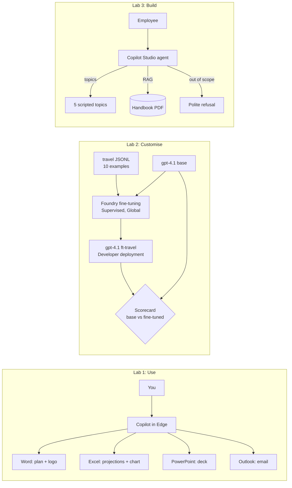

# Prince Hands-on Labs: Microsoft Copilot, Fine-tuning and Copilot Studio Agents

Three no-code labs that show the **three main ways a business uses generative AI** on Microsoft's stack:

| | Lab | Approach | You build | Time | Cost |
|---|---|---|---|---|---|
| 1 | [Copilot in Edge](labs/01-copilot-in-edge.md) | **Use** an AI assistant | A business launch pack: plan + logo (Word), projections + chart (Excel), investor deck (PowerPoint), email (Outlook) | 45–60 min | Free |
| 2 | [Fine-tune a language model](labs/02-fine-tune-a-language-model.md) | **Customise** a model | A fine-tuned `gpt-4.1` travel assistant in Microsoft Foundry, compared with the base model | 30 min + training wait | Typically under US $1 |
| 3 | [Copilot Studio agent](labs/03-copilot-studio-agent.md) | **Build** a grounded agent | *Prince Workplace Assistant*: answers from an employee handbook (RAG), 5 topics, refuses off-topic requests | 45–60 min | Free (trial) |

Every lab is click-by-click with expected results, ✅ checkpoints, a clean-up step and a troubleshooting table.

## What this project is

A practical tour of generative AI for business, without writing code:

- **Lab 1** turns one rough idea document into a full set of investor materials with Copilot.
- **Lab 2** proves, with a scorecard, whether fine-tuning beats prompt engineering for a specific behaviour (tone and boundaries).
- **Lab 3** builds an internal assistant that answers policy questions **from a company document, with citations**, and stays in its lane.

## Why industry needs it

| Business problem | Lab | Result |
|---|---|---|
| Knowledge workers spend hours drafting plans, decks, numbers and emails | 1 | First drafts in minutes; people edit instead of starting from a blank page |
| A chatbot must sound on-brand and follow rules *every* time, not just most of the time | 2 | A model trained on example conversations behaves more consistently, and you have evidence it does |
| HR and IT answer the same policy questions every day | 3 | Self-service answers grounded in the official handbook, with sources, 24/7 |

## Why the design

| Decision | Why |
|---|---|
| **Use → customise → build**, in that order | Mirrors how companies adopt AI: start with off-the-shelf assistants, customise only when needed, then build agents on their own data |
| **Baseline before fine-tuning** (Lab 2) | Fine-tuning costs time and money; you need proof it beats a good prompt |
| **gpt-4.1 with Supervised fine-tuning** | Supports SFT with Global training and the cheap Developer deployment. gpt-5 only supports reinforcement fine-tuning, by invitation |
| **Developer deployment** for the fine-tuned model | Pay per token, no hourly hosting fee, deleted after 24 hours: right for evaluation |
| **RAG instead of fine-tuning** for policies (Lab 3) | Policies change. Update the document, not the model, and every answer has a citation |
| **General knowledge off + refusal rules** (Lab 3) | An internal agent shouldn't answer stock tips or trivia; scope is a safety and trust feature |
| **Sample data in the repo** | No broken download links; everything you upload is in [`assets/`](assets) |

## Architecture



## Prerequisites

| Lab | You need |
|---|---|
| 1 | Microsoft Edge + a **personal** Microsoft account (outlook.com / hotmail.com) |
| 2 | An **Azure subscription** with Owner or Contributor rights |
| 3 | A **work or school** Microsoft account (Lab 3, Step 0 shows how to get one) |

## Repo layout

```
prince-copilot-finetuning-labs/
├── README.md
├── labs/
│   ├── 01-copilot-in-edge.md
│   ├── 02-fine-tune-a-language-model.md
│   └── 03-copilot-studio-agent.md
├── assets/
│   ├── Business-Idea.docx                  ← Lab 1 input document
│   ├── mopping.png                         ← Lab 1 image analysis
│   ├── financial-projections.csv           ← Lab 1 clean table for the chart
│   ├── travel-finetune-hotel.jsonl         ← Lab 2 training data (10 examples)
│   └── Prince-Corp-Employee-Handbook.pdf   ← Lab 3 knowledge source (fictional)
├── scripts/
│   └── validate_jsonl.py                   ← Lab 2: check the training file before upload
└── docs/
    ├── share-your-learnings.md
    └── interview-questions.md
```

## What's fixed compared with older versions of these labs

- **Lab 1:** working download links, no "More Balanced" step, a fix when Copilot can't read the page, the corrected `$10,000` prompt, expected numbers and a clean CSV for the chart.
- **Lab 2:** consistent base model (gpt-4.1 everywhere), why gpt-5 can't be used for supervised fine-tuning, a working dataset link, the `.jsonl.txt` trap, a file checker, a comparison scorecard and 10 troubleshooting fixes.
- **Lab 3:** correct account requirements, a real knowledge document, matching instructions and scenario, all 5 topics written out, guardrail settings, exact test questions with expected answers and 9 troubleshooting fixes.

## Documentation

- Copilot in Edge: https://support.microsoft.com/en-us/Microsoft-Copilot/getting-started-with-copilot-in-microsoft-edge
- Fine-tuning models and regions: https://learn.microsoft.com/en-us/azure/foundry/foundry-models/concepts/models-sold-directly-by-azure
- Model lifecycle and retirements: https://learn.microsoft.com/en-us/azure/foundry/concepts/model-lifecycle-retirement
- Deploy and test fine-tuned models (Developer tier): https://learn.microsoft.com/en-us/azure/ai-services/openai/how-to/fine-tune-test
- Fine-tuning cost management: https://learn.microsoft.com/en-us/azure/foundry/openai/how-to/fine-tuning-cost-management
- Copilot Studio trial sign-up: https://learn.microsoft.com/en-us/microsoft-copilot-studio/sign-up-individual
- Copilot Studio knowledge sources: https://learn.microsoft.com/en-us/microsoft-copilot-studio/knowledge-copilot-studio

## After the labs

- [Share your learnings](docs/share-your-learnings.md): screenshots and LinkedIn templates
- [Interview questions](docs/interview-questions.md): 60-second pitch and Q&A for all three labs

## Summary

You used an AI assistant to produce real business documents, customised a model and measured whether it helped, and built a grounded, scoped agent on company data. That's the full **use → customise → build** path that companies follow with generative AI.

---

**Prince Hands-on Labs** by [SHADRACK-NAKOBA](https://github.com/SHADRACK-NAKOBA). Lab content adapted from Microsoft Learning's open-source exercises (MIT); see [THIRD-PARTY-NOTICES.md](THIRD-PARTY-NOTICES.md). Prince Corp and its handbook are fictional. Released under the [MIT licence](LICENSE).
